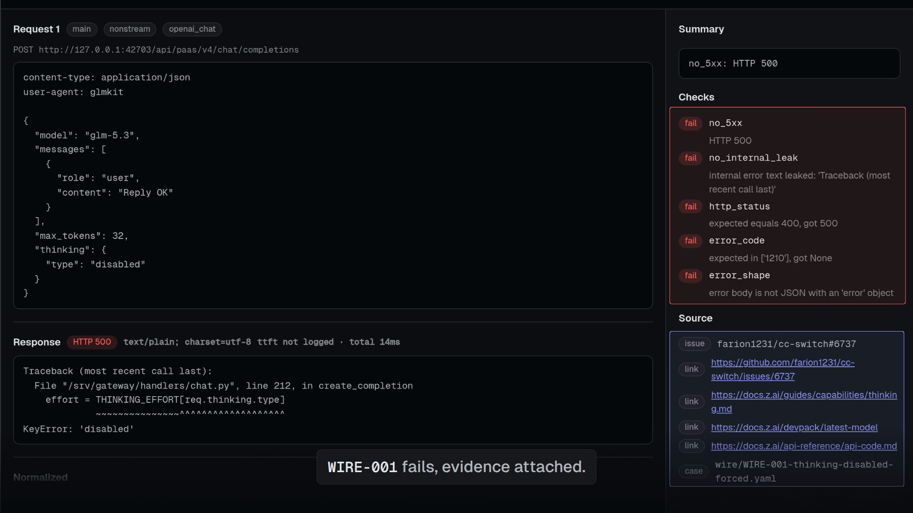
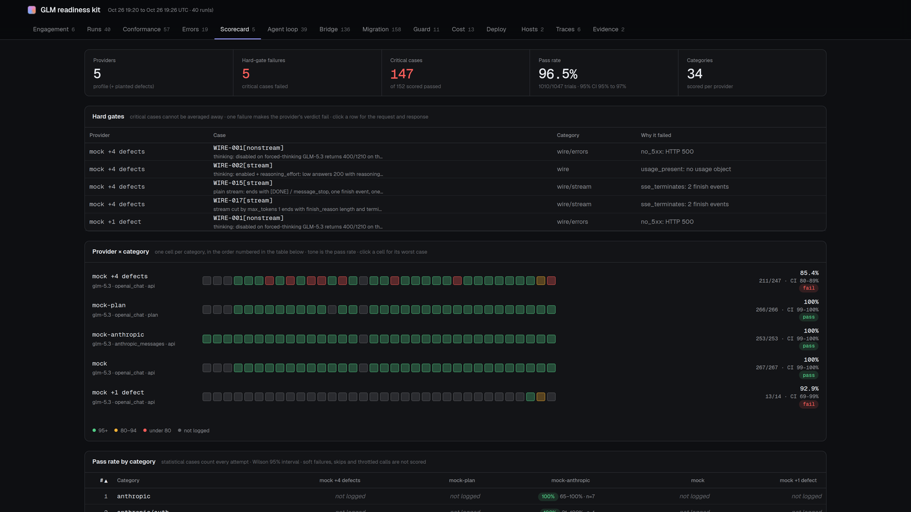
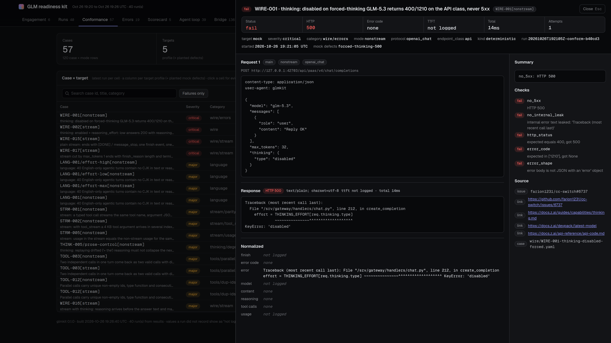
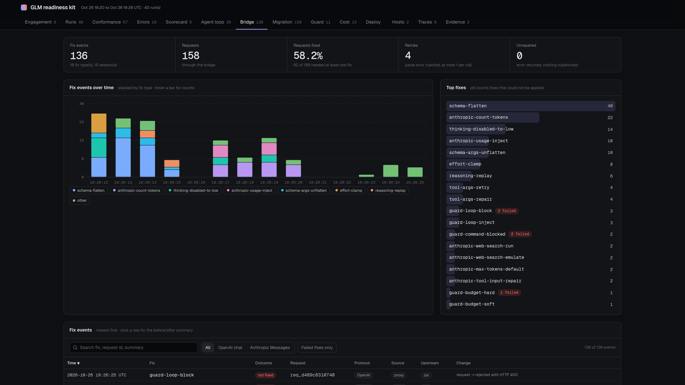
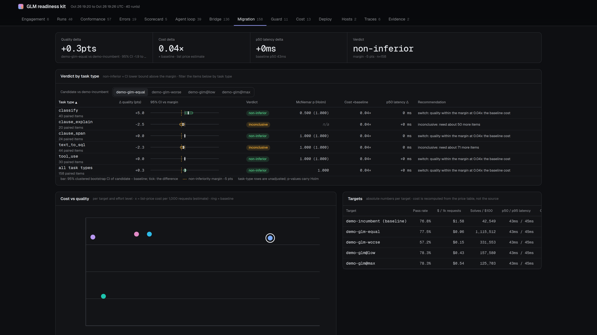
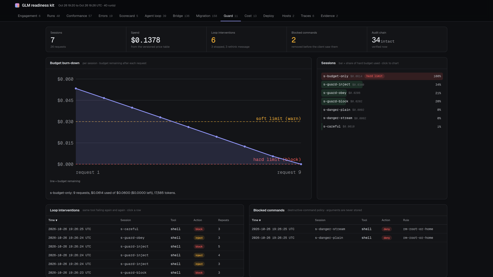
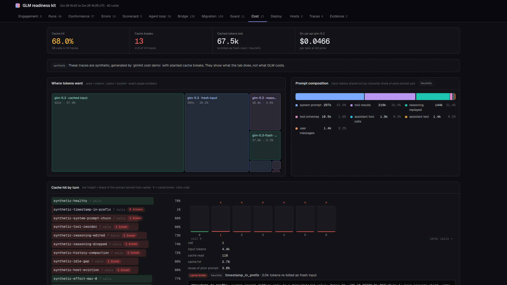
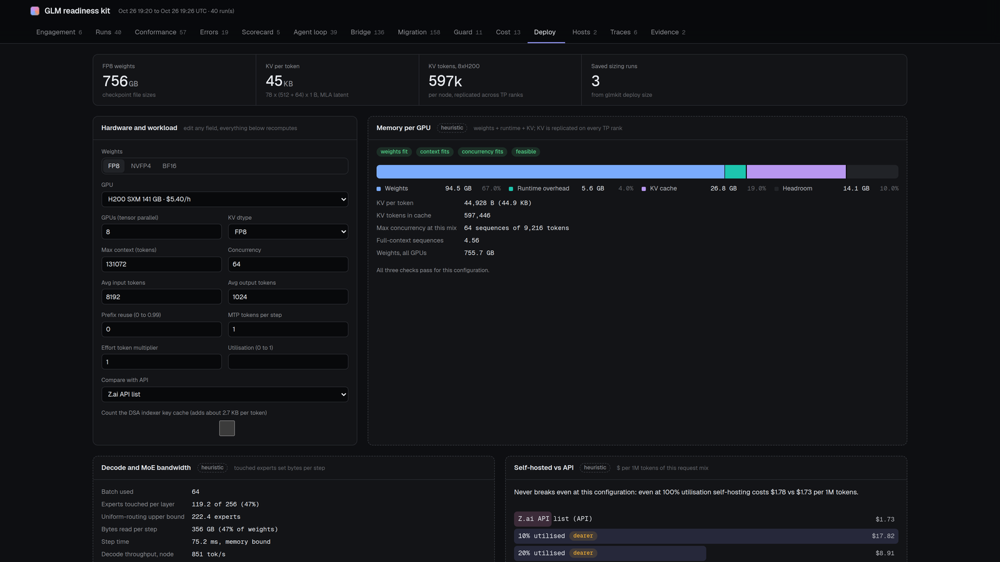
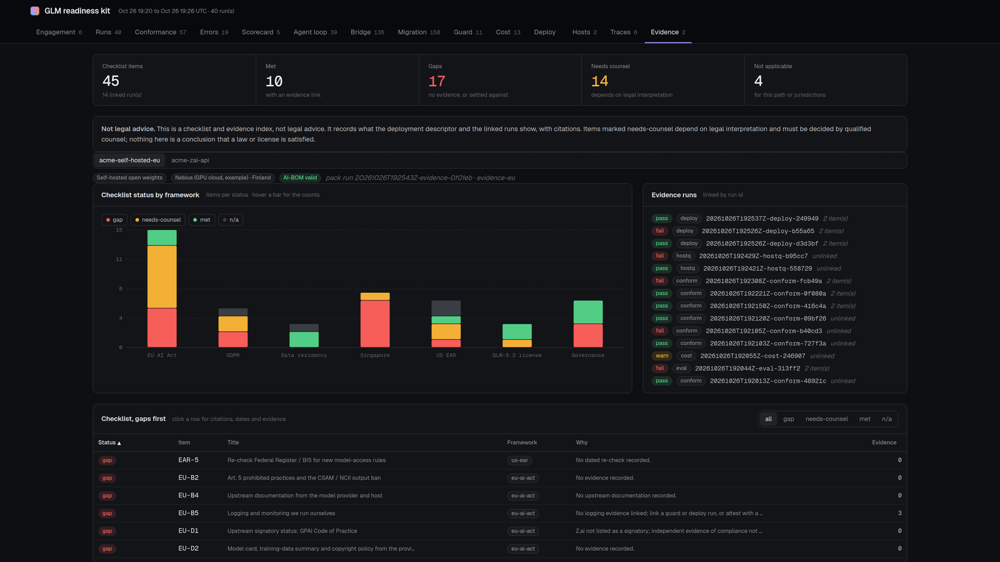
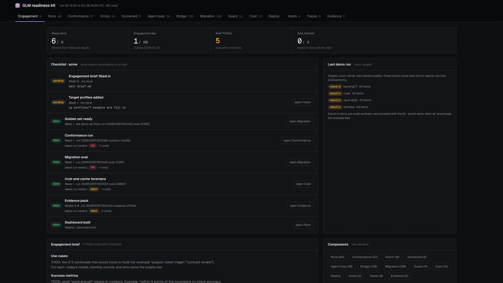

# GLM Production Readiness Kit (`glmkit`)

An open-source kit a forward-deployed engineer runs in the first weeks of a GLM enterprise engagement. It answers
five questions: does GLM work on this host and harness (conformance), can we make it work (bridge), should this
workload move (migration eval), what will it cost (cost and cache forensics, deploy sizing), and can compliance sign
off (evidence pack). Each step is one CLI command that writes JSON results, and one static dashboard shows them all.
Everything runs against a deterministic mock GLM server first, and every check is shown to fail on a planted
upstream bug before it touches a real endpoint.

**Watch the 77-second walkthrough:**

[](docs/media/glmkit-walkthrough.mp4)

<sub>Click the image to play ([MP4, 9.7 MB](docs/media/glmkit-walkthrough.mp4)). Everything shown runs against the deterministic mock server.</sub>

**Status:** 17 of 19 issues done. Every result so far comes from the mock server; the live run against Z.ai
endpoints ([#16](issues/16-live-verification.md)) is the next step and needs real API keys.



<sub>All screenshots come from mock runs with synthetic data (the mock GLM server, planted defects, bundled stand-in
golden sets and synthetic cost traces). They show what the kit reports, not how GLM performs.</sub>

## Quickstart

```sh
uv sync
uv run glmkit --help

# conformance against the in-process mock (no key, no network)
uv run glmkit conform run --target mock --cases 'WIRE-00*'

# the same with a planted upstream bug: WIRE-001 fails and the evidence shows the 500 + traceback
uv run glmkit conform run --target mock --cases 'WIRE-00*' --mock-defect forced-thinking-500

# static dashboard (opens from disk)
uv run glmkit report build results/ -o site/
open site/index.html
```

The whole pipeline in one command, offline (about 43 s on the mock): `uv run glmkit init acme`, then from inside
`acme/` run `uv run glmkit demo run`. It runs conformance, eval, cost, evidence and builds the dashboard.

Real targets: `uv run glmkit profiles list` shows the 12 shipped endpoint profiles (Z.ai API and Coding Plan on
both protocols, OpenRouter, a generic OpenAI-compatible host, local vLLM/SGLang, the mock). Keys are read only
from the environment variable each profile names (for example `ZAI_API_KEY`) and are redacted from every
result, trace and log.

The mock can also run standalone: `uv run glmkit mock serve --defect forced-thinking-500`
(`uv run glmkit mock defects` lists the defects).

## What it does

### Conformance: does GLM work on this host and harness?

`glmkit conform run --target <profile>` runs 67 conformance cases in 13 categories (wire and errors, tools,
thinking, streaming, Anthropic endpoint, cache, usage, language, latency, limits, multimodal, auth, downgrade
fingerprinting). Each case cites the Z.ai doc or the GitHub issue it comes from. Critical cases are hard gates: one
failure fails the target. `glmkit conform host` compares a host against a recorded reference fingerprint to flag a
quantized or swapped model.

Proof of method: plant `forced-thinking-500` in the mock and WIRE-001 fails. The evidence drawer shows the request
(`"thinking": {"type": "disabled"}`), the HTTP 500 with a leaked Python traceback where a 400/1210 was expected,
the five failed checks and the source issue.



### Bridge: can we make it work?

`glmkit bridge serve --upstream <profile>` is a local proxy that fixes known GLM wire problems in front of any
client: OpenAI SDKs on `/v1`, the Anthropic SDK and Claude Code through `ANTHROPIC_BASE_URL`. Examples: thinking
disabled rewritten to `low` on forced-thinking models, tool schemas flattened, broken tool arguments repaired,
missing usage injected. Every fix is logged as an event. The same rewriters also ship as a LiteLLM plugin
([docs/bridge-litellm.md](docs/bridge-litellm.md)). `glmkit bridge flavors` lists the upstream behaviour profiles.



### Migration eval: should this workload move?

`glmkit eval run --set <golden-set> --baseline <incumbent> --targets <candidates>` replays a golden set (or
production traces imported with `glmkit traces import` from OTel, Langfuse, OpenAI, Anthropic, LiteLLM or Claude
Code exports) on the incumbent and on GLM at each effort level. It grades both and gives a paired verdict per task
type: non-inferior, inferior, or inconclusive with an estimate of how many more items are needed.



### Guard, and cost and cache forensics: what will it cost?

`glmkit bridge serve --guard` adds per-session and per-key spend budgets, a loop detector for agents repeating a
failing tool call, a destructive-command gate (`glmkit guard policy`, `glmkit guard check`), and a hash-chained
audit log (`glmkit guard verify`). See [docs/guard.md](docs/guard.md).

`glmkit cost analyze <traces>` finds where the prompt cache broke in real traces and the likely cause (timestamp in
the prefix, reordered tools, reasoning not replayed and others; causes are labelled heuristic), and prices the
re-billed tokens from a versioned price table with sources.

| Guard | Cost and cache forensics |
|---|---|
|  |  |

### Deploy sizing and evidence pack: self-host, and can compliance sign off?

`glmkit deploy size --model glm-5.3 --gpu h200 --gpus 8 --context 128k --concurrency 64` does the MoE maths
(weights, MLA KV per token, KV capacity, bandwidth-bound throughput) and the self-hosted vs API break-even.
`glmkit deploy validate` recomputes 44.9 KB/token and 755.7 GB FP8 weights from the model config and file listing.
[deploy/](deploy/README.md) holds reference configs for vLLM, SGLang and llm-d, and `glmkit deploy health` runs
the WIRE cases against a running endpoint.

`glmkit evidence build --deployment <descriptor> --results results/` builds a checklist and evidence index for EU AI
Act, GDPR, data residency, Singapore, US export control and the model license. Each item is linked to the run IDs
that back it, and a CycloneDX 1.6 AI-BOM is included. Items are marked met, gap, needs-counsel or n/a. It is not
legal advice, and the pack says so.

| Deploy sizing | Evidence pack |
|---|---|
|  |  |

### FDE workbench and engagement

`glmkit init <customer>` scaffolds an engagement workspace: brief, target profiles, golden-set template, task list
and a 90-day README. `glmkit status` derives which steps are done from the files and results on disk. The dashboard
has 14 tabs: engagement, runs, conformance, errors, scorecard, agent loop, bridge, migration, guard, cost, deploy,
hosts, traces and evidence.



## How it's verified

- **Mock first.** The mock GLM server serves the OpenAI and Anthropic paths and can switch on 66 named defects,
  most of them reproducing reported upstream bugs. Every check was shown to fail with its planted defect and pass
  without it; the commands and output are in each issue's Evidence section ([issues/](issues/README.md)).
- **Tests.** `uv run pytest`: 741 passed, 1 skipped (needs `helm`). 29 LiteLLM integration tests are deselected by
  default because they start a real LiteLLM proxy (`pytest -m litellm`).
- **Keys.** Read only from environment variables and redacted from every result, trace and log.
- **Not yet verified live.** The mock's default behaviour follows the Z.ai docs and public bug reports. No check
  has run against a real Z.ai endpoint yet. That run is [#16](issues/16-live-verification.md): it turns the
  unverified claims into confirmed or refuted facts with run IDs and tightens the mock wherever reality differs.

## Status

17 of 19 issues on the [issue board](issues/README.md) are done. Two are blocked because they need the owner's
API keys and a spend cap: [#16 live verification](issues/16-live-verification.md) and
[#17 public readiness report](issues/17-public-report.md), which depends on #16.

## Layout

| Path | What |
|---|---|
| `src/glmkit/contracts/` | Shared contracts: endpoint profile, conformance case, result envelope, evidence, SwitchTrace v0 |
| `src/glmkit/client/` | Async client for OpenAI-chat and Anthropic-Messages, stream and non-stream, with TTFT and evidence |
| `src/glmkit/mock/` | Mock GLM server; `mock/defects/` holds one module per planted upstream bug |
| `src/glmkit/conform/` | Conformance runner; `conform/checks/` holds the named oracles |
| `src/glmkit/bridge/` | Bridge proxy and rewriters (OpenAI and Anthropic paths, LiteLLM plugin) |
| `src/glmkit/guard/` | Budgets, loop detector, destructive-command policy, audit log |
| `src/glmkit/eval/` | Migration eval: replay, graders, paired non-inferiority verdicts |
| `src/glmkit/cost/` | Cost and cache forensics, price table |
| `src/glmkit/deploy/` | MoE sizing calculator, reference checks |
| `src/glmkit/evidence/` | Evidence pack: checklist, AI-BOM, HTML and Markdown pages |
| `src/glmkit/report/` | Static dashboard builder; `report/pages/` holds one module per tab |
| `cases/` | Conformance cases as YAML data (`cases/<category>/<ID>-slug.yaml`) |
| `deploy/` | Reference deployments for vLLM, SGLang and llm-d (config only, never applied) |
| `schemas/` | Exported JSON Schemas of the contracts (`glmkit schema export`) |
| `docs/` | `contracts.md` (contracts and extension points), `guard.md`, `bridge-litellm.md`, `screenshots/` |
| `research/` | Background research behind the cases, bridge, eval and deploy/compliance work |
| `issues/` | Local issue board, one file per issue with acceptance criteria and evidence |
| `tools/site-smoke/` | Headless Chrome check of a built dashboard (console errors, tabs, drawer, 1440/390 px) |

Development: `uv run pytest` and `uv run ruff check`. Dashboard smoke:
`npm install --prefix tools/site-smoke && node tools/site-smoke/smoke.mjs site/index.html`.

## License

MIT (see `LICENSE`). The dashboard vendors the Observatory UI design system
(https://github.com/Nainish-Rai/observatory-ui, MIT); its license is kept in
`src/glmkit/report/vendor/observatory/LICENSE`.
